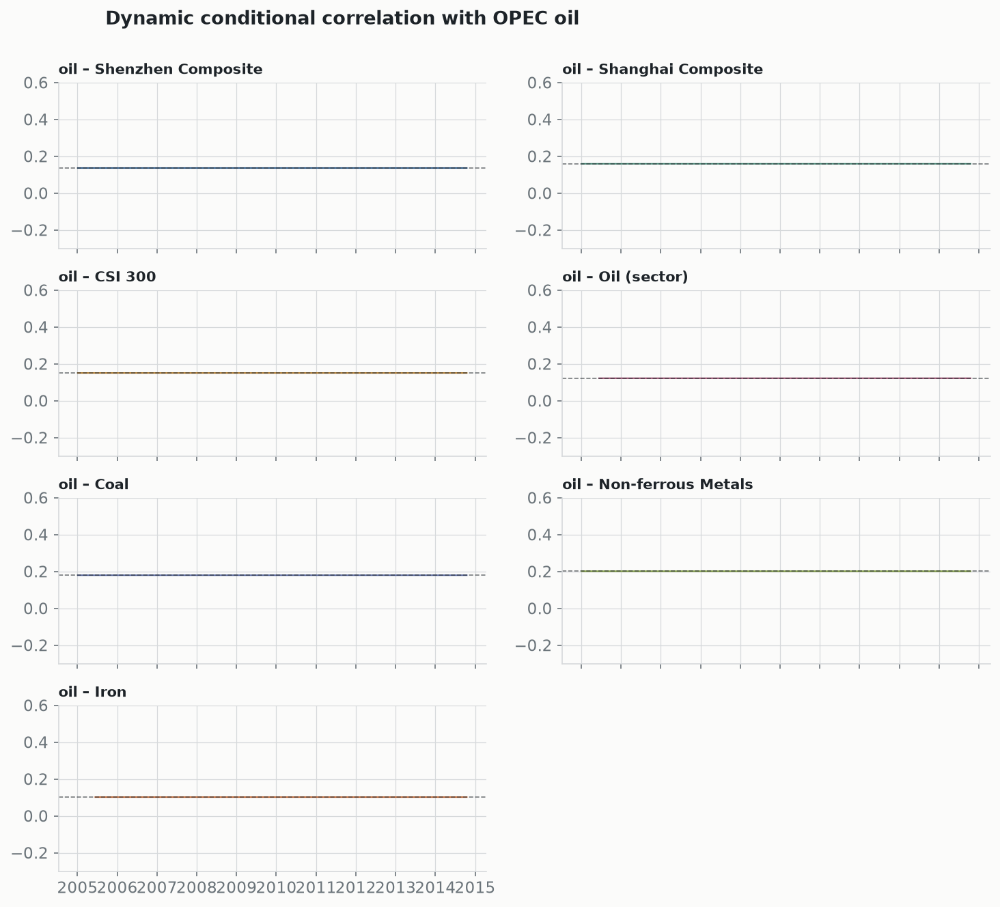
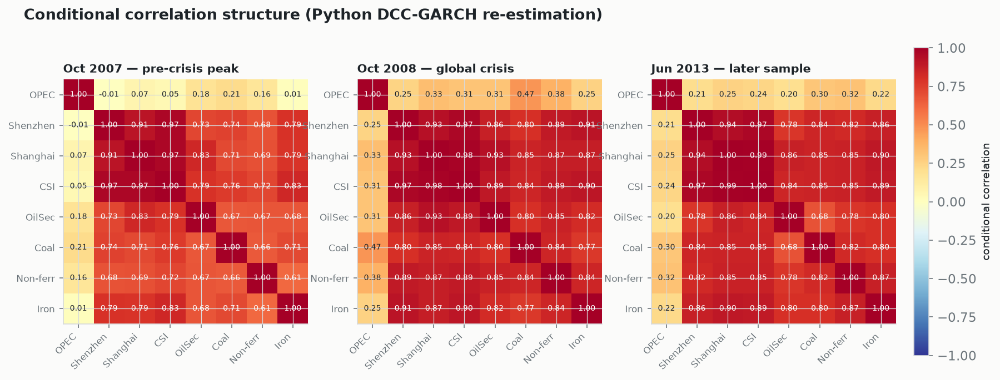
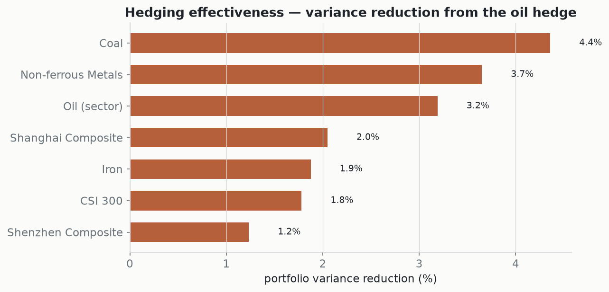
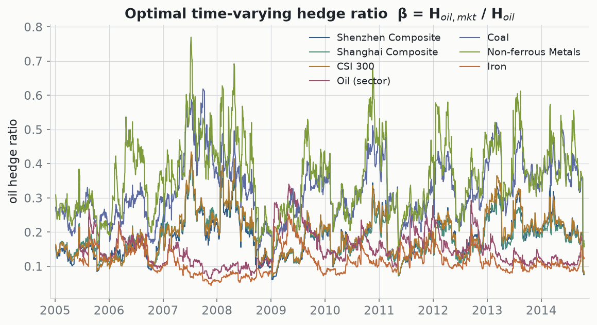
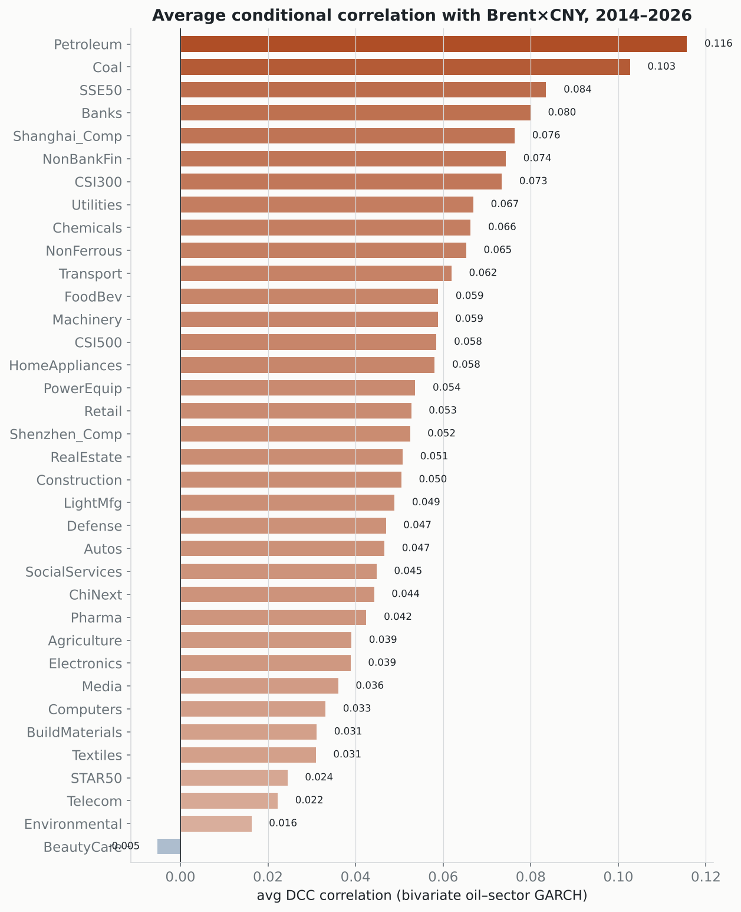
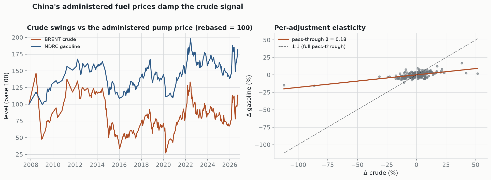
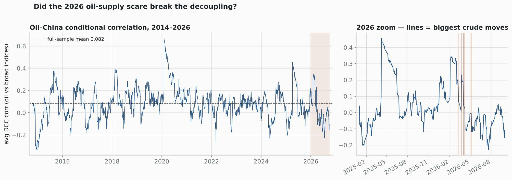

# Oil–China Volatility Spillover & Hedging

Reproducible analysis for:

> **The interactions between OPEC oil price and sectoral stock returns: Evidence from China**
> Berna Kirkulak-Uludağ & **Omid Safarzadeh**, *Physica A: Statistical Mechanics and its Applications*, **508** (2018) 631–641.
> [doi:10.1016/j.physa.2018.02.185](https://doi.org/10.1016/j.physa.2018.02.185)

[](https://www.python.org/)
[](LICENSE)
[](https://doi.org/10.1016/j.physa.2018.02.185)

How does the price of **OPEC oil** transmit volatility to **Chinese stock markets**, and can oil hedge a Chinese equity portfolio? Using daily data from Dec 2004 to Oct 2014, the paper fits multivariate GARCH models (BEKK, DCC, VARMA-GARCH) to OPEC oil and seven Chinese series — the Shanghai, Shenzhen and CSI 300 indices and the oil, coal, non-ferrous-metals and iron sector indices — and derives optimal hedge ratios from the time-varying covariances.

This repository makes that analysis **reproducible in pure Python** — data prep, descriptive tests, hedging quantities, and every figure — straight from the committed data and the model outputs. No Google Colab, no Google Drive mounts.

## Key findings, reproduced

**Oil is weakly linked to Chinese markets, and the link is time-varying.** From the DCC-GARCH re-estimation, the conditional correlation with oil sits around 0.1–0.2 for most of the sample and rises during the 2008 global crisis, but never approaches the tight co-movement among the Chinese series.



(The paper's published McAleer VAR-CCC model holds correlation *constant* by construction, so its time-variation lives entirely in the variances and hedge ratios; the time-varying correlation shown here comes from the Python DCC-GARCH re-estimation.)

The correlation matrix makes the cross-section explicit: the OPEC-oil row stays low through the 2007 run-up, the 2008 crisis, and the later sample, while the Chinese series move tightly together (≈0.7–0.98).



**That weak link makes oil an effective hedge — most for the energy-intensive sectors.** Adding oil to a sector portfolio reduces variance most for coal (4.4%) and non-ferrous metals (3.7%), least for the broad indices.



**The optimal hedge ratio moves over time** — from the VARMA-GARCH conditional covariances, β₍ₜ₎ = H₍oil,mkt₎ / H₍oil₎:



(Price levels, log-return series, and conditional-volatility figures are produced alongside these — see `results/figures/`.)

## Reproduce it

Requires Python 3.10+.

```bash
git clone https://github.com/Bellman281/Spillover_Paper.git
cd Spillover_Paper
python -m venv .venv && source .venv/bin/activate      # Windows: .venv\Scripts\activate
pip install -r requirements.txt

# run everything: tables -> figures -> Python DCC re-estimation -> GIF
PYTHONPATH=src python -m spillover
```

Outputs land in `results/` (`tables/*.csv`, `figures/*.png`, `figures/*.gif`).
Skip the slower DCC re-estimation and GIF with `--no-dcc`.

## What runs in Python vs. RATS

The paper's multivariate GARCH models were estimated in **RATS** (commercial). To keep the repository fully runnable on free tools, the pipeline separates the two:

| Step | Tooling here | Notes |
|------|--------------|-------|
| Data prep, log returns, descriptive stats & tests (Table 1) | **Python** | ADF, Jarque–Bera, Ljung–Box, ARCH-LM via `statsmodels`/`scipy` |
| Hedge ratios, portfolio weights, conditional vols, figures | **Python** | derived from the committed RATS H-matrices (`rats/hmatrices/`), oil column auto-detected |
| BEKK / DCC / VARMA-GARCH estimation (the published numbers) | **RATS** | original `.RPF` code and `.xls` outputs are in `rats/` |
| DCC-GARCH **re-estimation** (correlation-matrix figure) | **Python** | two-step DCC (`arch` + QMLE) — a faithful, open approximation, **not** identical to the published RATS point estimates |

So the published results are reproduced from their model outputs, and the modelling is *also* demonstrated end-to-end in Python — with the honest caveat that the Python DCC is an approximation of the RATS VARMA-GARCH, not a bit-for-bit match.

## Validation

The hedging math is checked against the paper's own `hedging.xlsx` (run `PYTHONPATH=src python -m pytest tests/`):

- **Hedge-ratio formula** — β = H_cov / H_oil, computed from the workbook's own H-matrix columns, reproduces its `hedg ratio` column exactly (max error ≈ 1e-17).
- **Oil-column detection** — the H-matrix exports do *not* use a fixed column order. The pipeline detects which diagonal is oil (it's the one series common to all seven bivariate models) rather than assuming it. This mattered: before the fix, two sectors (CI005001, CI005005, where oil is variable 2) used the wrong variance and their hedge ratios were ~30% off.
- **Cross-check** — for the one sector where the workbook and the H-matrix export cleanly correspond (CI005001), the pipeline's hedge ratio matches the workbook (0.150).

**What is _not_ claimed:** bit-for-bit reproduction of the published tables. The estimation ran in RATS; `hedging.xlsx` is a partial working file (some sheets are duplicated/stale); and this data is the companion sector specification (oil, coal, non-ferrous, iron), not the published paper's main sector set. The figures are faithful derivations of the committed VARMA-CCC model outputs; the Python DCC-GARCH is an independent re-estimation.

## A decade later — does the result still hold? (2014–2026)

The published study ran to October 2014. The [`extension-2014-2025`](EXTENSION.md) branch re-asks the question on a fresh sample that now runs to **September 2026**, using the *same* pure-Python DCC-GARCH engine on both periods. The short answer: **the conclusion holds, and if anything it has strengthened.** Oil is an even weaker co-mover with Chinese equities than it was a decade ago — confirmed four independent ways.

### 1. The oil–China link has fallen further

Running the identical method on both samples, the average oil–China conditional correlation **fell from 0.166 (2004–2014) to 0.094 (2014–2026)**, and hedging effectiveness from 3.5% to 1.2%. Oil diversifies Chinese equities even better now; the lower hedging effectiveness is just the flip side — with so little oil-driven variance left, there is less for an oil hedge to remove.


### 2. It's the whole market, not the paper's seven series

Scanning oil against a broad **36-sector** universe (Shenwan Level-1 industries plus the major broad indices), **not one sector clears a correlation of 0.12.** The strongest oil link in the entire Chinese market is the petroleum sector itself (0.116), then coal (0.103); banks, tech, pharma, autos and the rest all sit below 0.09. Mean |correlation| across everything is just **0.053**. The ranking is economically sensible — the two physically oil-exposed sectors lead, growth/defensive names trail — which is itself a check that the signal is real.



### 3. Why — China's administered fuel prices absorb the shock

The mechanism, measured on real NDRC retail-price data: the pass-through of crude to the pump is **β ≈ 0.18 for gasoline and 0.20 for diesel** (robust SEs, n = 291). Only about a fifth of a crude move reaches the Chinese consumer — the state absorbs the rest via a $40/$130 crude band, a skip-small-moves rule, and a ~40% fixed tax wedge. With the domestic cost of oil deliberately smoothed, oil-price swings carry little information for Chinese demand, corporate margins, or equity returns.



### 4. It even survives the 2026 oil-supply scare

The sample now spans the 2026 US–Iran / Strait of Hormuz period — a natural stress test. Tracking the *time-varying* oil–China correlation and marking the biggest crude moves of 2026 (data-driven, no event date assumed): the 2026 average correlation is just **0.010**, the peak only **0.34** (briefly, in early February), and on the most violent crude days of the year (−12% to −16%) the correlation sat **near zero**. A genuine oil shock pulled oil around wildly; Chinese equities barely noticed.



> **Caveats.** This is a consistent-method comparison (Python DCC-GARCH on both periods), not a RATS replication — see *What runs in Python vs. RATS* above. The Chinese sector indices here are **Shenwan** industry indices used as a free stand-in for the paper's CITIC sectors. And the 2026 crude tail shows some extreme daily moves that post-date verification — sanity-check `OilRmb` for spring 2026 against a primary source (EIA / a terminal) before quoting specific days. See [`EXTENSION.md`](EXTENSION.md) for the full runbook; every fetcher takes `--oil brent|wti` and `--start/--end`.

## Robustness & refinements

Is the weak result real, or an artifact of the daily DCC-GARCH? Three stress-tests (full write-up in [`ROBUSTNESS.md`](ROBUSTNESS.md)) say the broad-market decoupling is real, but the daily single-average framing understated the energy-sector hedge and the crisis behaviour:

- **Horizon.** Brent closes after the Chinese session, so daily same-date returns are non-synchronous. The energy-sector hedge roughly *triples* at a realistic weekly/biweekly horizon (oil sector hedging effectiveness 1.9% → 5.8%), while the broad indices stay flat at every horizon. The weak hedge is partly a daily-frequency artifact — but only where a real link exists. (`scripts/multihorizon.py`)
- **Direction.** Oil Granger-causes the Chinese oil and coal sectors at *every* lag 1–5 (p < 0.001), with no reverse causality — the small-open-economy pattern, and the reason the same-day correlation looks weak (the transmission is lagged). The broad-market effect is shallow (Shanghai significant only at lags 1–3; CSI 300 marginal). Long-run: only coal shows an economically sensible cointegration with oil. (`scripts/granger_vecm.py`)
- **Regime.** A 2-state Markov-switching model shows the oil–China correlation roughly *doubles* in the turbulent volatility regime (Shanghai 0.07 → 0.13, coal 0.10 → 0.18) — oil diversifies until a crisis, then the link reappears. (`scripts/regimes.py`)

A scoped plan for the monetary-policy angle (with an honest difficulty read) is in [`docs/monetary_policy_plan.md`](docs/monetary_policy_plan.md).

## Repository layout

```
data/raw/        source.csv (prices), symbols.csv
rats/            original RATS code (.RPF) and H-matrix outputs (.xls)
src/spillover/   the Python package
  data.py         load prices, log returns
  descriptive.py  Table 1 — moments + specification tests
  hmatrix.py      read H-matrices -> correlations, hedge ratios, effectiveness
  garch.py        pure-Python two-step DCC-GARCH
  scan.py         bivariate oil-vs-sector DCC scan engine
  extension.py    two-period analyze / compare
  plots.py        all static figures
  __main__.py     one-command pipeline
scripts/         extension runbook (fetch_data, fetch_scan, scan_sectors,
                 fetch_fuel, fuel_passthrough, run_extension, oil_shock_window)
                 robustness (multihorizon, granger_vecm, regimes)
results/         generated tables and figures
  extension/      two-period comparison (REPORT.md)
  scan/           36-sector oil-correlation scan (SCAN.md)
  fuel/           administered-price pass-through (FUEL.md)
  shock/          2026 oil-shock window (SHOCK.md)
  multihorizon/   hedge by horizon (MULTIHORIZON.md)
  causality/      Granger + VECM (CAUSALITY.md)
  regimes/        regime-switching correlation (REGIMES.md)
docs/            data dictionary + monetary_policy_plan.md
EXTENSION.md     decade-later runbook   ROBUSTNESS.md  robustness write-up
```

## Citation

If you use this, please cite the paper ([`CITATION.bib`](CITATION.bib)):

> Kirkulak-Uludağ, B., & Safarzadeh, O. (2018). The interactions between OPEC oil price and sectoral stock returns: Evidence from China. *Physica A*, 508, 631–641. https://doi.org/10.1016/j.physa.2018.02.185

Analysis code is MIT-licensed. The article is © Elsevier; data are included for replication only.
