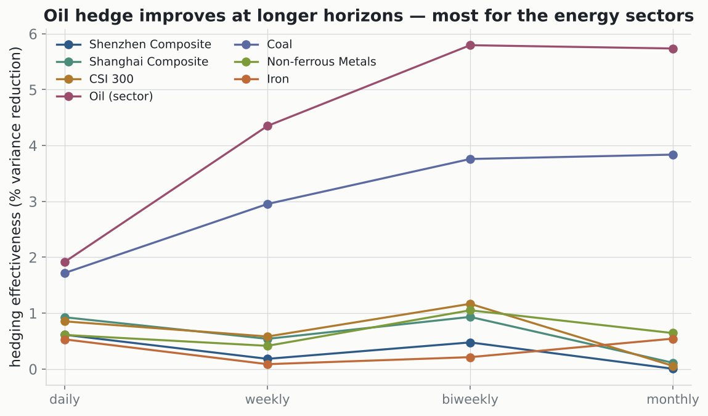
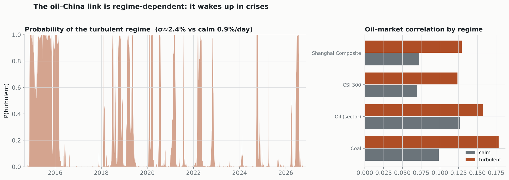

# Robustness & refinements

The decade-later extension found the oil–China link *weak* and the hedge
*unimpressive* — in the 2014–2026 sample, average hedging effectiveness is only
~1%. That invites an honest question: is the weak result real, or an artifact of
the daily DCC-GARCH the paper uses? This note stress-tests it three ways. The
short answer: **the broad-market decoupling is real, but the daily single-average
framing understated two things — the energy-sector hedge, and the crisis
behaviour.** Each refinement is reproducible from the committed data.

> Scope: consistent-method Python DCC-GARCH and standard time-series tests on
> `data/raw/source_extension.csv` (2014-10 → 2026-09). Shenwan industry indices
> stand in for the paper's CITIC sectors. See the main README for the
> Python-vs-RATS caveat.

## 1. Horizon — the daily hedge understates the energy sectors

Brent closes hours *after* the Chinese session, so same-date daily returns are
non-synchronous and understate any real link. Re-computing the static optimal oil
hedge at longer horizons:

| horizon | Oil sector HE | Coal HE | broad indices |
|---|---:|---:|---|
| daily | 1.9% | 1.7% | ~0.5–0.9% |
| weekly | 4.4% | 3.0% | ~0.5% |
| biweekly | **5.8%** | **3.8%** | ~0.5–1.2% |
| monthly | 5.7% | 3.8% | ~0% |

The energy-sector hedge roughly **triples** from daily to biweekly (oil sector
1.9% → 5.8%; correlation 0.14 → 0.24), while the broad indices stay flat at every
horizon. So the "weak hedge" is partly a daily-frequency artifact — **but only
where a real economic link exists**. The broad-market decoupling survives every
horizon. *(`scripts/multihorizon.py`)*

## 2. Direction — oil leads the energy sectors (Granger), not the reverse

On daily returns, oil **Granger-causes** the Chinese oil and coal sectors at
*every* lag 1–5 (p < 0.001), while neither sector leads oil. The broad market is
weaker: Shanghai is significant only at the shortest lags (1–3 days, p = 0.006 at
lag 1) and fades; CSI 300 is marginal (p ≈ 0.05 at lag 1, nothing beyond). This
is the small-open-economy pattern — a global price sets the tempo for a local
sector — and it is *why* the same-day correlation looks weak: the transmission is
lagged, so a contemporaneous DCC misses it.

The long-run (Johansen/VECM) evidence is weaker and read honestly: only **coal**
shows an economically sensible cointegration with oil (β ≈ 1.2). The broad-index
cointegrations are statistically flagged but economically hollow — near-zero
error-correction speed and an implausible β (~12) that just reflects A-shares
trending while oil stayed range-bound. The oil sector index itself is *not*
cointegrated with oil: it reacts day-to-day but is domestically driven over the
long run. *(`scripts/granger_vecm.py`)*

## 3. State — the link wakes up in crises (regime-switching)

A single full-sample average hides the real structure. A 2-state Markov-switching
model on CSI 300 volatility splits the decade into a calm regime (σ ≈ 0.9%/day)
and a turbulent one (σ ≈ 2.4%/day, ~21% of the time). The oil–China correlation
is **state-dependent** — roughly doubling in the turbulent regime:

| market | calm | turbulent |
|---|---:|---:|
| Shanghai | 0.07 | 0.13 |
| CSI 300 | 0.07 | 0.12 |
| Oil sector | 0.13 | 0.16 |
| Coal | 0.10 | 0.18 |

Oil diversifies right up until a crisis, when the link reappears and the
diversification benefit fades exactly when it is most needed — the classic
"correlations rise in a crisis" story, made explicit, and invisible to one flat
number. The turbulent-regime timeline lines up with 2015, 2020, 2022, and a 2026
spike. *(`scripts/regimes.py`)*

## What this does to the paper's story

Nothing here overturns the headline — oil is a genuinely weak co-mover with the
broad Chinese market, and that is robust to horizon, direction, and regime. What
the refinements add is honesty and precision:

- The **oil/coal hedge** is ~3× better than the daily DCC implies, at the weekly
  horizon a real hedger would use.
- Oil **leads** the energy sectors (one-directional), which reframes the
  spillover as predictive, not just contemporaneous.
- The diversification benefit is **regime-dependent**, strongest in calm markets
  and weakest in crises.

Put together, the recent-decade story is cleaner stated as: *oil is a
near-zero-beta diversifier for the broad Chinese market, a modest weekly hedge for
the energy sectors that it leads by about a day, and a diversifier whose benefit
narrows in turbulent regimes.*

## Next

- **Monetary policy** — does PBoC stance modulate the link? Scoped in
  [`docs/monetary_policy_plan.md`](docs/monetary_policy_plan.md), with an honest
  difficulty read (the identification is the hard part, not the code).
- **FX dilution** — `OilRmb = Brent × USD/CNY` injects FX noise; re-running with
  Brent-in-USD should lift the sector correlations further.
- **10Y China gov bond** — add as a fourth asset for a proper multi-asset
  diversification / Sharpe test.
