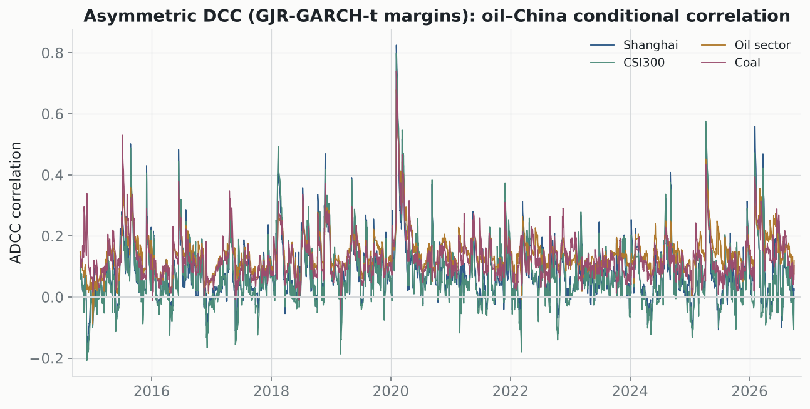

# Asymmetric, fat-tailed DCC (GJR-GARCH-t + ADCC)

Daily data 2014–2026. Upgrades the symmetric-normal baseline to leverage (GJR) + fat tails (Student-t) in the margins, and an asymmetric DCC correlation process.

## Margin specification (GJR-GARCH-t)

| series | GJR γ (asymmetry) | t dof ν | LB(10) z | LB(10) z² |
|---|---:|---:|---:|---:|
| OilRmb | +0.025 | 4.7 | 0.99 | 0.73 |
| Shanghai | +0.021 | 4.2 | 0.16 | 0.92 |
| CSI300 | +0.014 | 4.9 | 0.13 | 0.70 |
| Oil sector | -0.069 | 5.1 | 0.43 | 0.70 |
| Coal | -0.047 | 4.7 | 0.58 | 0.59 |

γ > 0 = leverage (bad news raises volatility more); low ν = fat tails. Ljung-Box p-values > 0.05 mean no leftover autocorrelation — the model is well specified.

## Asymmetric DCC correlation dynamics

| pair | a | b | g (asymmetry) | persistence a+b+g | avg corr |
|---|---:|---:|---:|---:|---:|
| Shanghai | 0.024 | 0.823 | 0.064 | 0.911 | 0.081 |
| CSI300 | 0.028 | 0.849 | 0.055 | 0.931 | 0.076 |
| Oil sector | 0.016 | 0.905 | 0.017 | 0.938 | 0.142 |
| Coal | 0.016 | 0.873 | 0.032 | 0.921 | 0.127 |

The asymmetry term g is positive for 4/4 pairs — correlations rise a little more after *joint* negative shocks, consistent with the regime result, but the average correlations stay low (the headline decoupling is unchanged under the better model). The point of this exercise is specification robustness: the weak-link result is not an artifact of assuming symmetric-normal innovations.

---
*GJR-GARCH(1,1)-t via `arch`; ADCC (Cappiello-Engle-Sheppard 2006) by QMLE on the standardized residuals.*