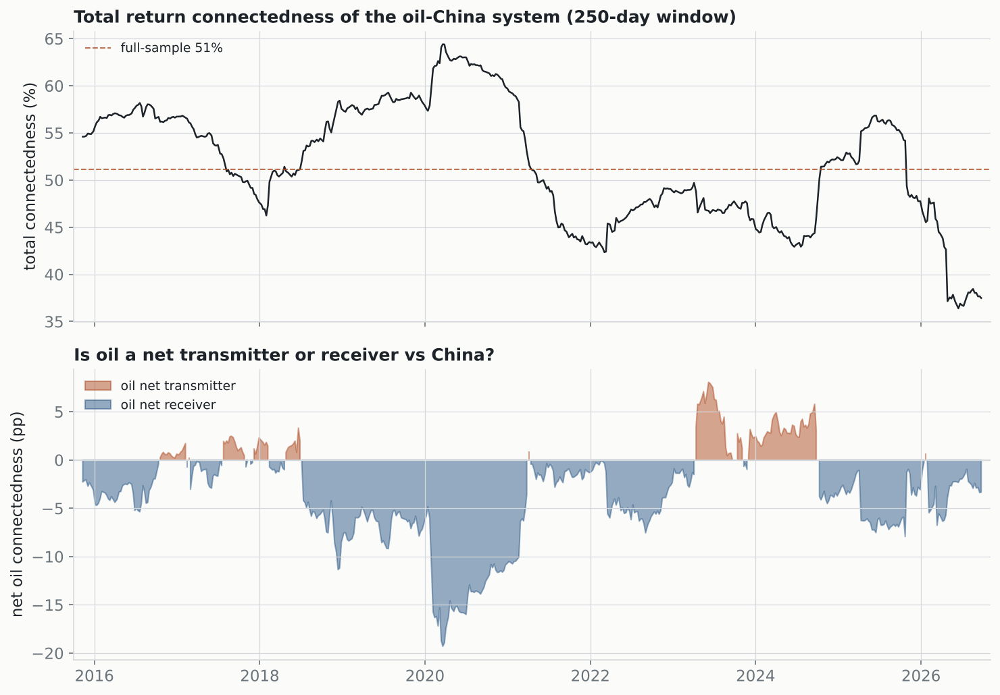

# Connectedness (Diebold-Yilmaz): directional oil-China spillovers

VAR + generalized FEVD, 10-step horizon, 2014–2026. System: oil + Shanghai + CSI 300 + the oil and coal sectors. Each cell is the % of row *i*'s forecast-error variance explained by shocks to column *j*.

## Headline

- **Total return connectedness: 51.1%** (volatility connectedness: 47.8%). Most of the system's variance is internal to the Chinese market, not shared with oil.
- **Oil is a near-isolated node:** it receives only **5.4%** of its variance from the Chinese series and transmits **3.5%** to them (net **-1.9 pp**). Compare that to the 60–90% totals typical of integrated asset systems.

## Static connectedness table — returns (%)

|           |   Oil |   Shanghai |   CSI300 |   OilSector |   Coal |   FROM |
|:----------|------:|-----------:|---------:|------------:|-------:|-------:|
| Oil       | 94.63 |       0.9  |     0.85 |        1.9  |   1.72 |   5.37 |
| Shanghai  |  0.42 |      34.09 |    32.02 |       19.73 |  13.75 |  65.91 |
| CSI300    |  0.37 |      34.53 |    36.81 |       16.69 |  11.6  |  63.19 |
| OilSector |  1.53 |      21.43 |    16.83 |       36.84 |  23.37 |  63.16 |
| Coal      |  1.2  |      17.02 |    13.33 |       26.53 |  41.92 |  58.08 |
| TO        |  3.51 |      73.88 |    63.03 |       64.85 |  50.44 | nan    |
| NET       | -1.86 |       7.97 |    -0.16 |        1.69 |  -7.64 | nan    |

`FROM` = received from others; `TO` = transmitted to others; `NET` = TO − FROM. A positive NET marks a net transmitter.

---
*Generalized FEVD (order-invariant). Total connectedness = mean FROM = share of total forecast-error variance that crosses series. Rolling panel: 250-day window, VAR(1).*