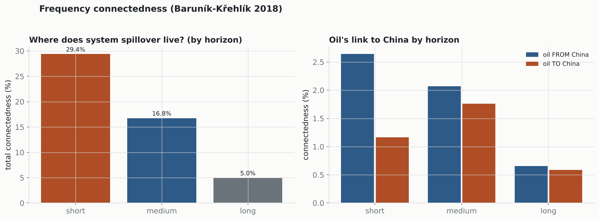

# Frequency connectedness (Baruník-Křehlík 2018)

Spectral decomposition of the generalized FEVD into horizon bands, 2014–2026. Validates against the time-domain Diebold-Yilmaz total (51.1%): bands reconstruct it to max error 4.66e-02.

## Total connectedness by horizon

| band | total connectedness | oil FROM | oil TO | oil NET |
|---|---:|---:|---:|---:|
| short (1-5d) | 29.4% | 2.6% | 1.2% | -1.5% |
| medium (5-22d) | 16.8% | 2.1% | 1.8% | -0.3% |
| long (22d+) | 5.0% | 0.7% | 0.6% | -0.1% |

Most system spillover is **high-frequency** (resolves within a week) — the hallmark of an efficiently-integrated market. Oil's (already small) link to China is concentrated at the short horizon too, consistent with the lead-lag / multi-horizon result: what little oil–China transmission exists happens fast and leaves no durable low-frequency component.

---
*Bands reconstruct the DY table exactly (printed check). Short 1–5d, medium 5–22d, long 22d+.*