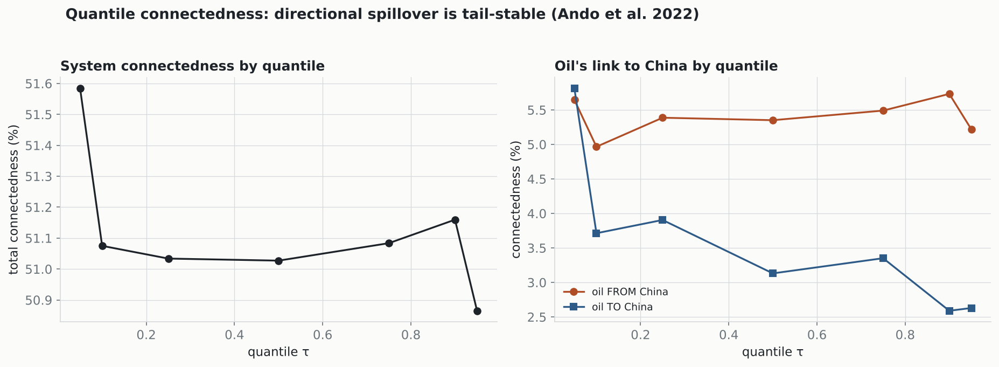

# Quantile connectedness (Ando et al. 2022)

Quantile-VAR(1) + generalized FEVD across quantiles, 2014–2026. Connectedness at the median vs the tails.

## Headline (an honest null that refines the regime result)

- **Directional connectedness is essentially quantile-invariant:** total is **51.6% (τ=0.05) / 51.0% (median) / 50.9% (τ=0.95)** — a range of only 0.7 pp across the whole grid. There is **no tail amplification** of *predictive* spillover.
- **Oil stays detached in the tails too:** oil's FROM-China connectedness is **5.6% / 5.4% / 5.2%** (τ = 0.05 / 0.5 / 0.95), flat to within 0.8 pp.

## Why this does not contradict the regime finding

The Markov-regime result (oil–China *correlation* roughly doubles in the turbulent volatility regime) and this quantile null are both true because they measure different things. The regime result is about **contemporaneous co-movement**: in a crisis oil and Chinese equities get more volatile *together*. Quantile connectedness is about **directional predictability**: whether oil's past *forecasts* Chinese returns better in the tails — and it does not. So the crisis amplification is a shared-volatility effect, not a predictive-spillover effect. Oil never becomes a leading indicator for Chinese crashes; the two simply wobble together when everything does. That distinction is a cleaner, more defensible claim than a blanket 'contagion in crises'.

| τ | total | oil FROM | oil TO | oil NET |
|---|---:|---:|---:|---:|
| 0.05 | 51.6% | 5.6% | 5.8% | +0.2% |
| 0.10 | 51.1% | 5.0% | 3.7% | -1.3% |
| 0.25 | 51.0% | 5.4% | 3.9% | -1.5% |
| 0.50 | 51.0% | 5.4% | 3.1% | -2.2% |
| 0.75 | 51.1% | 5.5% | 3.4% | -2.1% |
| 0.90 | 51.2% | 5.7% | 2.6% | -3.1% |
| 0.95 | 50.9% | 5.2% | 2.6% | -2.6% |

---
*QVAR via equation-by-equation quantile regression (statsmodels); GFEVD on the quantile-specific coefficients and residual covariance.*