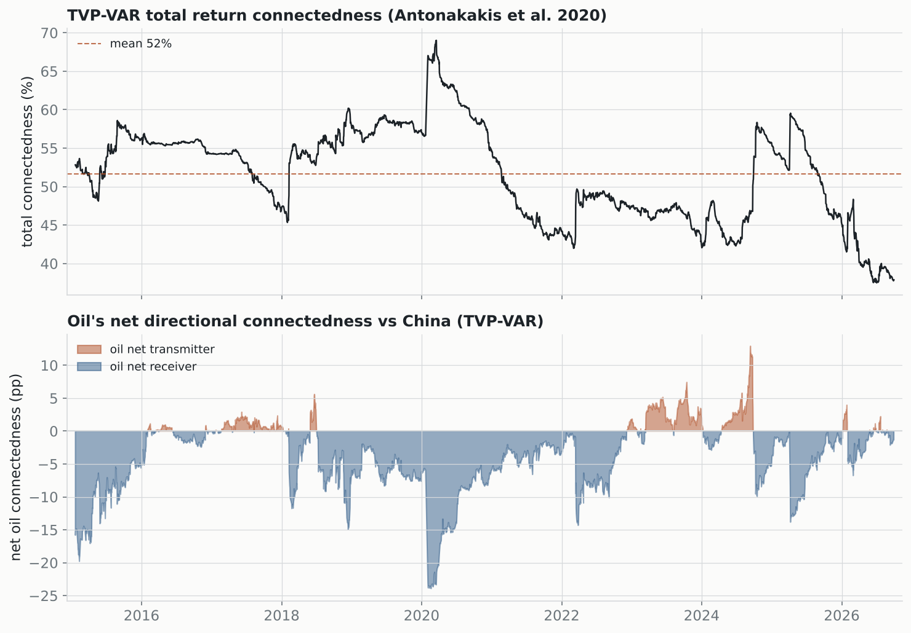

# TVP-VAR connectedness (current standard)

Forgetting-factor Kalman TVP-VAR(1) + generalized FEVD (λ₁=0.99, λ₂=0.99), the Antonakakis-Chatziantoniou-Gabauer (2020) refinement of Diebold-Yilmaz. No rolling window, no lost sample.

## Headline

- Mean total connectedness: **51.6%** (range 37–69%).
- Oil's mean connectedness to China: FROM **9.7%**, TO **5.9%**, net **-3.8 pp** (net receiver 75% of the time).

The TVP-VAR confirms the DY-2012 baseline without its window artefacts: the oil–China system is moderately connected internally, oil sits apart as a near-isolated, mostly net-receiving node, and both the total and oil's role move with the cycle — oil turns net transmitter in supply-shock episodes and net receiver in demand-shock crises.

---
*Compare `CONNECTEDNESS.md` (DY-2012 rolling baseline). Next: frequency (Baruník-Křehlík 2018) and quantile (Ando et al. 2022) connectedness.*