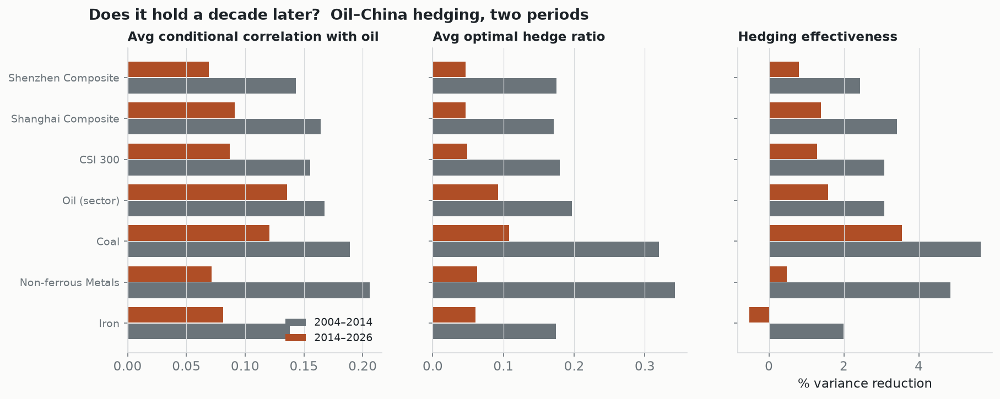

# Does the conclusion hold a decade later?

Same Python DCC-GARCH engine, two periods — **2004–2014** (2355 obs) vs **2014–2026** (2794 obs).

## Headline

- Average oil–market conditional correlation: **0.166 → 0.094**
- Average hedging effectiveness: **3.5% → 1.2%**

**The conclusion holds, and if anything strengthens.** Oil's conditional correlation with Chinese markets has *fallen* further over the decade, so oil is an even better diversifier than in the original sample. Hedging *effectiveness* is lower, but that is a consequence of the weaker link, not a contradiction: with oil and Chinese equities barely co-moving, there is little oil-driven variance left for an oil hedge to remove.

## Per-market comparison

| Market | corr (old → new) | hedge ratio (old → new) | hedging eff. (old → new) |
|---|---|---|---|
| Shenzhen Composite | 0.14 → 0.07 | 0.18 → 0.05 | 2.4% → 0.8% |
| Shanghai Composite | 0.16 → 0.09 | 0.17 → 0.05 | 3.4% → 1.4% |
| CSI 300 | 0.16 → 0.09 | 0.18 → 0.05 | 3.1% → 1.3% |
| Oil (sector) | 0.17 → 0.14 | 0.20 → 0.09 | 3.1% → 1.6% |
| Coal | 0.19 → 0.12 | 0.32 → 0.11 | 5.7% → 3.6% |
| Non-ferrous Metals | 0.21 → 0.07 | 0.34 → 0.06 | 4.8% → 0.5% |
| Iron | 0.14 → 0.08 | 0.17 → 0.06 | 2.0% → -0.5% |

---
*Method: two-step DCC-GARCH (arch + QMLE) on daily log returns. This is a consistent-method comparison, not a RATS replication; see the main README.*