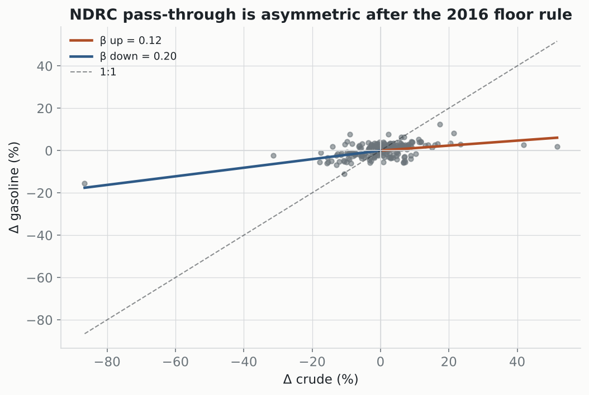

# NDRC pricing-rule natural experiment

Does the pass-through behave the way the **policy rule** says it should? If so, the administered-price channel is identified by design, not just asserted.

## 1. Pass-through before vs after the 2016 floor/ceiling rule

| regime | pass-through β | robust se | R² | n |
|---|---:|---:|---:|---:|
| pre-2016 (no floor) | 0.19 | 0.04 | 0.48 | 80 |
| post-2016 (floor/ceiling) | 0.17 | 0.02 | 0.28 | 211 |

## 2. Asymmetric pass-through (post-2016)

- **β up = 0.12** (se 0.04)  vs  **β down = 0.20** (se 0.02)  — gap **-0.09**.

**This is the *opposite* of the $40-floor prediction.** A floor that blocks price cuts would make the downside pass through *less* (β_down < β_up). Instead crude *decreases* pass through **more** than increases. That pattern fits a different policy feature — consumer-protective *capping of increases* (the ceiling / the political economy of pump prices) — not the floor. It is a real asymmetry, but it does not identify the floor channel, and reading it as 'the ceiling' after seeing the sign would be fitting the story to the data.

## 3. Floor-binding events (crude < $40): was the pump frozen?

| date | crude | Δ gasoline |
|---|---:|---:|
| 2016-01-14 | $31 | 2.3% |
| 2020-03-18 | $25 | 15.4% |
| 2020-11-06 | $39 | 2.6% |

Only **three** events ever put crude below the floor, and they are mixed: two show small pump moves (consistent with a freeze), but **2020-03-18** shows a 15% move with crude at $25 — the opposite of a freeze. Three observations cannot identify anything, and one contradicts the prediction.

## Honest verdict

**The natural experiment does not cleanly identify the administered-price mechanism.** Pass-through did fall modestly after the 2016 rule (0.20 → 0.17), which is weakly consistent with tighter administration, but the key identifying tests fail: the asymmetry runs opposite to the floor prediction, and the floor-binding events are too few and internally contradictory. The *descriptive* fact — damped, asymmetric pass-through — holds; the *causal* claim that the NDRC floor rule drives the oil-equity decoupling is **not** established by this test. The mechanism remains, at this stage, suggestive rather than identified.

---
*OLS with White-robust SEs on NDRC adjustment events. The 2016 rule date, $40 floor and up/down split are set by the policy, not fit to the data. Reported straight, including the results that cut against the hypothesis.*